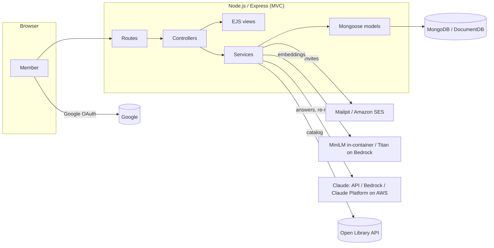
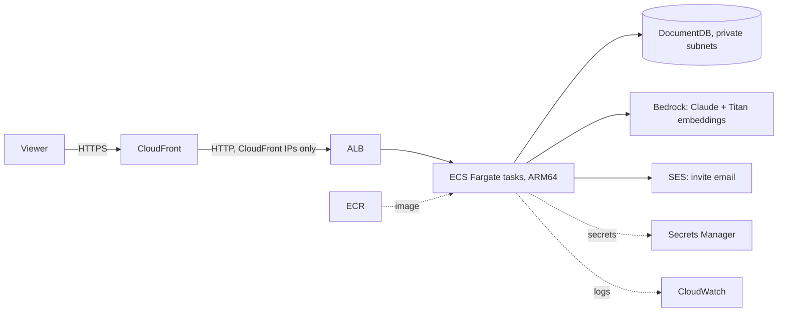

# Bookclub

A web app for running a book club. Leaders invite members by email, members sign in with Google, and the club keeps its shelf, reviews and meeting notes in one place. Two AI features sit on top:

- **Ask the club** (RAG): ask questions like "Which book did we disagree about the most?" and get an answer grounded in the club's own reviews and notes, with citations.
- **What next?** (AI recommendations): suggestions weighted by members' ratings, re-ranked and explained by Claude.

## How each requirement is covered

| Requirement | Where it lives |
|---|---|
| Leader invites users | `src/services/invites.js`, `src/controllers/inviteController.js`. Single-use hashed tokens, expiry, resend (rotates the token), revoke, and the Google account's email must match the invite |
| Google auth | `src/config/passport.js` (Passport + `passport-google-oauth20`), sessions stored in MongoDB |
| MVC | `src/models` (Mongoose), `src/views` (EJS), `src/controllers`, routes in `src/routes` |
| NoSQL database | MongoDB locally, Amazon DocumentDB on AWS. Same Mongoose models for both |
| AI recommendation system | `src/services/recommender.js`: taste vector from ratings, MMR diversity, Claude re-rank with structured output |
| RAG | `src/services/rag.js` + `vectorStore.js` + `indexer.js`: hybrid retrieval, Claude answers with native citations |
| AWS | `infra/terraform`: ECS Fargate, ECR, DocumentDB, ALB, CloudFront, Secrets Manager, SES, Bedrock (Claude + Titan embeddings), CloudWatch |
| Docker | `Dockerfile` + `docker-compose.yml`: app, MongoDB, Mailpit (invite inbox), mongo-express (database browser) |

## Quick start (Docker)

```bash
cp .env.example .env
```

```bash
docker compose up --build
```

| URL | What |
|---|---|
| http://localhost:3000 | The app |
| http://localhost:8025 | Mailpit: every invite email lands here |
| http://localhost:8081 | mongo-express: browse the NoSQL collections (login `admin` / `bookclub`) |

Without any keys you can already try everything:

1. Open http://localhost:3000/login and use **Sign in without Google** (dev login, local only).
2. On the dashboard, click **Load a demo club**. It creates "The Lamplight Readers" with members, ratings, reviews and meeting notes.
3. Try **Ask the club**, **What next?**, and the invite form. Open Mailpit to click the invite link, then sign in as the invited email in a private window to accept.

With no LLM configured, Ask shows the retrieved passages and recommendations use similarity only. Add a Claude key (below) for written, cited answers and explained picks.

### Turn on Google sign-in

1. In [Google Cloud Console → Credentials](https://console.cloud.google.com/apis/credentials), create an **OAuth client ID** (type: Web application).
2. Add the authorized redirect URI `http://localhost:3000/auth/google/callback`.
3. Put the ID and secret in `.env` as `GOOGLE_CLIENT_ID` and `GOOGLE_CLIENT_SECRET`, then run `docker compose up -d`.

### Turn on Claude

Pick one in `.env`:

- **Claude API:** `LLM_PROVIDER=anthropic` and `ANTHROPIC_API_KEY=...`
- **Amazon Bedrock:** `LLM_PROVIDER=bedrock`, `AWS_REGION`, plus AWS credentials. Model `anthropic.claude-opus-5-5`.
- **Claude Platform on AWS:** `LLM_PROVIDER=aws`, `AWS_REGION`, `ANTHROPIC_AWS_WORKSPACE_ID`, plus AWS credentials.

The default model is Claude Opus 5.5 (`claude-opus-5-5`); override it with `LLM_MODEL`. On the Claude API and Claude Platform on AWS, requests opt into server-side refusal fallbacks (`fallbacks: "default"`). Bedrock doesn't support that parameter, so a declined request there shows a friendly message, and recommendations fall back to similarity ranking.

## Architecture



```
src/
  config/        env config, DB connection, Passport Google strategy
  models/        User, Club, Invite, Book, Review, Note, Chunk   ← M
  views/         EJS templates + presentation helpers            ← V
  controllers/   thin request handlers                           ← C
  routes/        URL → controller map, auth/leader guards
  middleware/    auth, club access, CSRF, flash, errors
  services/      invites, mailer, Open Library, indexer, vector store, RAG, recommender
    ai/          Claude client factory, embedding providers
  seed/          starter catalog + demo club
infra/terraform/ AWS infrastructure
scripts/         seed, reindex, retrieval eval, deploy
test/            node:test unit tests
```

### Data model (MongoDB collections)

- `users`: Google identity, profile, cached personal recommendations
- `clubs`: leader, embedded `members[]` (role) and `books[]` (status: upcoming / reading / finished), cached club recommendations
- `invites`: club, email, **sha256 of the token**, status, expiry, send count
- `books`: shared catalog (seed + Open Library), with an embedding vector per book
- `reviews`: one per member per book per club (rating 1-5 + text)
- `notes`: meeting notes
- `chunks`: the RAG knowledge base. Passages from books, reviews and notes, each with its embedding
- `sessions`: login sessions (connect-mongo)

## How the AI works

### Ask the club (RAG)

1. **Index.** Whenever a book is added or a review or meeting note is saved, `indexer.js` splits the text into passages (one per paragraph, up to about 900 characters) and stores each one with its embedding in `chunks`.
2. **Retrieve.** The question is embedded and every passage in that club is scored by cosine similarity, plus a keyword-overlap boost (hybrid search), then the top 6 are taken. Retrieval is scoped to one club, so clubs never see each other's notes.
3. **Generate.** The passages go to Claude as `search_result` content blocks with citations enabled. Claude's answer comes back with `search_result_location` citations, which the UI renders as numbered links to the original review or note.

`npm run eval:rag` runs 8 known questions against the demo club and reports hit@3 and MRR. Hybrid scoring with paragraph chunks moved it from 6/8 (MRR 0.80) to 8/8 (MRR 0.94) over pure cosine with fixed-size chunks.

Similarity is computed in the app, which is exact and portable across MongoDB, DocumentDB and Atlas, and fast at book-club scale (thousands of passages). To scale further, swap `vectorStore.search` for Atlas `$vectorSearch` or a DocumentDB vector index.

### What next? (recommendations)

1. **Taste profile.** A weighted average of the embeddings of books the club has read. A 5-star average weighs +2.5 and a 1-star average weighs -1.5, so disliked books push the profile away.
2. **Candidates.** The shared catalog, expanded from Open Library using the themes of the best-liked books.
3. **Shortlist.** The 60 candidates closest to the taste profile, narrowed to 12 with Maximal Marginal Relevance so the list isn't five near-duplicates.
4. **Re-rank and explain.** Claude receives the reading history (ratings and review excerpts) and the shortlist, and returns its picks as JSON-schema structured output. Ids are checked against the shortlist, so it can't invent books. Without Claude, the app explains each pick by its nearest well-liked book and shared themes.

Personal recommendations (**For you**) run the same pipeline over one member's ratings across all their clubs.

## Deploying to AWS



Prerequisites: AWS CLI with credentials, Docker, Terraform 1.6+, and a Google OAuth client.

```bash
cp infra/terraform/terraform.tfvars.example infra/terraform/terraform.tfvars
```

Fill in the values, then:

```bash
./scripts/deploy.sh
```

The script creates the ECR repository on first run, builds and pushes the image, and applies the rest of the stack. When it finishes:

1. Add the printed `google_oauth_redirect_uri` to your Google OAuth client.
2. Click the verification link SES emails to `ses_from_email`.
3. While the account is in the **SES sandbox**, invites only reach verified addresses. Request production access to email anyone.
4. Make sure the Claude model is enabled for your account in the Bedrock console (Model access).

Design notes:

- **HTTPS without a domain.** CloudFront serves the app on `*.cloudfront.net`, which Google OAuth accepts. Set `domain_aliases` + `acm_certificate_arn` to use your own domain.
- **No AWS keys in the app.** Bedrock, Titan and SES calls use the ECS task role. Secrets (session secret, DocumentDB URI, Google secret) come from Secrets Manager.
- **No NAT gateway.** Tasks run in public subnets behind security groups that only accept traffic from the ALB. DocumentDB sits in private subnets with no internet route.
- **Cost.** Roughly $100/month before AI usage, mostly the DocumentDB instance (about half), Fargate and the ALB. Check the AWS Pricing Calculator for your region. Run `terraform destroy` in `infra/terraform` to tear it all down.
- **State.** Terraform state contains secrets. Use the encrypted S3 backend stub in `versions.tf`.
- **`llm_provider = "aws"`** (Claude Platform on AWS) also needs that service's IAM actions added to the task role. See the Claude Platform on AWS docs.

## Development without Docker

You need Node 22+ and a MongoDB, for example `docker compose up -d mongo mailpit`.

```bash
npm install
```

```bash
npm run dev
```

| Command | What it does |
|---|---|
| `npm test` | Unit tests (vector math, chunking, invite rules, retrieval scoring, recommender weighting) |
| `npm run eval:rag` | Retrieval quality eval against the demo club |
| `npm run seed -- --demo --leader you@gmail.com` | Create the demo club for a real account |
| `npm run reindex` | Rebuild every club's knowledge base (run after changing `EMBEDDING_PROVIDER`) |

## Configuration

| Variable | Default | Notes |
|---|---|---|
| `APP_URL` | `http://localhost:3000` | Public URL, used for OAuth callback and invite links |
| `MONGODB_URI` | `mongodb://localhost:27017/bookclub` | DocumentDB URI in AWS |
| `SESSION_SECRET` | dev value | Required in production |
| `GOOGLE_CLIENT_ID` / `GOOGLE_CLIENT_SECRET` | | Required in production |
| `DEV_LOGIN_ENABLED` | `false` (`true` in compose) | Ignored when `NODE_ENV=production` |
| `LLM_PROVIDER` | `anthropic` if a key is set, else `none` | `anthropic`, `bedrock`, `aws`, `none` |
| `LLM_MODEL` | `claude-opus-5-5` (`anthropic.claude-opus-5-5` on Bedrock) | |
| `EMBEDDING_PROVIDER` | `local` | `local` (MiniLM in the container) or `bedrock` (Titan v2) |
| `MAIL_PROVIDER` | `console` (`smtp` in compose) | `ses`, `smtp`, `console` |
| `MAIL_FROM` | `Bookclub <no-reply@bookclub.local>` | Must be an SES-verified identity in AWS |
| `INVITE_TTL_DAYS` | `14` | |
| `INVITE_REQUIRE_EMAIL_MATCH` | `true` | Signed-in email must equal the invited email |
| `OPEN_LIBRARY_ENABLED` | `true` | Book search and catalog expansion |

## Security notes

- Invite tokens: 256-bit random, only the SHA-256 hash is stored, rotated on resend, expiring, single use, bound to the invited email.
- CSRF tokens on every form, `helmet` security headers with a strict CSP, `httpOnly` + `sameSite=lax` session cookies (`secure` in production).
- Club pages return 404 to non-members, and leader-only actions are enforced server-side.
- AI endpoints are rate-limited per user (30 requests per 15 minutes).
- The RAG system prompt tells Claude to treat member-written records as data, not instructions.
